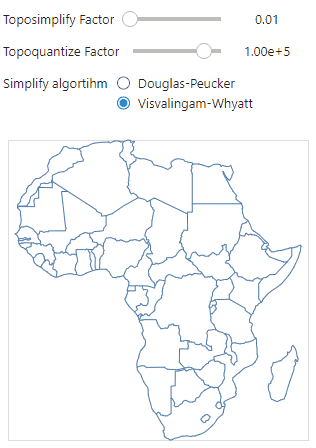

# Retrieval data types

```python exec="on" session="exampleoutput-types"
import threading
from concurrent.futures import ThreadPoolExecutor

import markdown_exec._internal.formatters.python as _python

# Zensical renders pages in parallel threads; GDAL and PROJ (geopandas) crash when
# they are used from more than one thread, so every example runs on one thread
with _python.__dict__.setdefault("_one_thread_lock", threading.Lock()):
    if not hasattr(_python, "_one_thread"):
        _python._one_thread = ThreadPoolExecutor(max_workers=1)
        _run = _python.exec_python

        def _exec_python(*args, **kwargs):
            return _python._one_thread.submit(_run, *args, **kwargs).result()

        _python.exec_python = _exec_python

import numpy as np
import topojson as tp


class _Drawing:
    def __getattr__(self, name):
        return lambda *args, **kwargs: self

    __or__ = __and__ = __add__ = lambda self, other: self


for _name in ["to_alt", "to_svg", "to_widget"]:
    setattr(tp.Topology, _name, lambda self, *args, **kwargs: _Drawing())
try:
    import geopandas

    geopandas.GeoDataFrame.plot = property(lambda self: lambda *a, **k: _Drawing())
except ImportError:
    pass
```

Multiple functions are available to serialize the Topology object. All of them are shown in this table below including the required hard and soft dependencies and further described below.

| Functions                       | Required Packages                                                       |
| ------------------------------- | ----------------------------------------------------------------------- |
| topojson.Topology().to_json()   | Shapely, NumPy                                                          |
| topojson.Topology().to_dict()   | Shapely, NumPy                                                          |
| topojson.Topology().to_svg()    | Shapely, NumPy                                                          |
| topojson.Topology().to_geojson()    | Shapely, NumPy                                                          |
| topojson.Topology().to_alt()    | Shapely, NumPy, _Altair\*_                                                |
| topojson.Topology().to_gdf()    | Shapely, NumPy, _GeoPandas\*_                                             |
| topojson.Topology().to_widget() | Shapely, NumPy, _Altair*_, _Simplification\*_, _ipywidgets*_ |

_\* optional dependencies_

**Note:** Only the serialization to different output types is described here. See ['settings and tuning'](settings-tuning.md) for detailed examples of all options regarding creating the Topology object. 

1. [.to_json()](#to_json)
2. [.to_dict()](#to_dict)
3. [.to_svg()](#to_svg)
4. [.to_geojson()](#to_geojson)
5. [.to_alt()](#to_alt)
6. [.to_gdf()](#to_gdf)
7. [.to_widget()](#to_widget)


* * *

## .to_json()

Serialize the Topology object into JSON. This is what is called TopoJSON.

!!! example


    Given the following two polygons:
    ```python
    import topojson as tp
    from shapely import geometry

    data = [
        {"type": "Polygon", "coordinates": [[[0, 0], [1, 0], [1, 1], [0, 1], [0, 0]]]},
        {"type": "Polygon", "coordinates": [[[1, 0], [2, 0], [2, 1], [1, 1], [1, 0]]]}
    ]
    geometry.GeometryCollection([geometry.shape(g) for g in data])
    ```

    ```python exec="on" session="exampleoutput-types"
    import topojson as tp
    from shapely import geometry

    data = [
        {"type": "Polygon", "coordinates": [[[0, 0], [1, 0], [1, 1], [0, 1], [0, 0]]]},
        {"type": "Polygon", "coordinates": [[[1, 0], [2, 0], [2, 1], [1, 1], [1, 0]]]}
    ]
    geometry.GeometryCollection([geometry.shape(g) for g in data])
    ```
    <figure class="parts" data-src="../json/fig_output_two_polygons.json" data-label="Two squares that share a side"><svg></svg></figure>

    The Topology can be computed

    ```python
    topo = tp.Topology(data)
    ```

    ```python exec="on" session="exampleoutput-types"
    topo = tp.Topology(data)
    ```

    And serialized and saved into a JSON (TopoJSON) file:
    ```python
    topo.to_json('my_file.topo.json')
    ```

    To inspect the JSON object first, leave out the filepath (`fp`) argument.
    ```python
    print(topo.to_json())
    ```

    ```python exec="on" session="exampleoutput-types" result="text"
    print(topo.to_json())
    ```
    Default is a compact form of JSON. If you like a more readable format, set `pretty=True`.
    ```python
    print(topo.to_json(pretty=True))
    ```

    ```python exec="on" session="exampleoutput-types" result="text"
    print(topo.to_json(pretty=True))
    ```
    The `pretty` option depends on the setting `indent` and `maxlinelength`, these default to `4` and `88` respectively.


* * * 

## .to_dict()

Serialize the Topology object into a Python Dictionary.

!!! example


    We use the data as is prepared in the [.to_json()](output-types.md#to_json) section.

    ```python
    topo.to_dict()
    ```

    ```python exec="on" session="exampleoutput-types" result="text"
    _ = topo.to_dict()
    if isinstance(_, dict):
        print(__import__('pprint').pformat(_, sort_dicts=False, width=88))
    else:
        print(_)
    ```
    In the computation of the Topology object a few options are adopted. To include these options in the Python Dictionary use `options=True`.

    ```python
    topo.to_dict(options=True)
    ```

    ```python exec="on" session="exampleoutput-types" result="text"
    _ = topo.to_dict(options=True)
    if isinstance(_, dict):
        print(__import__('pprint').pformat(_, sort_dicts=False, width=88))
    else:
        print(_)
    ```
    With `state=True`, also the hash of the input geometry of each feature (`source_hashes`) is included, so that the Topology can be read back with `Topology.read_json` and updated, see [incremental updates](incremental-updates.md). The same applies to `.to_json()`.


* * * 

## .to_svg()

Serialize the Topology object into a visual Support Vector Graphic (SVG) mesh.

!!! example


    We use the data as is prepared in the [.to_json()](output-types.md#to_json) section.
    ```python
    topo.to_svg()
    ```

    ```python exec="on" session="exampleoutput-types"
    topo.to_svg()
    ```
    <figure class="parts" data-src="../json/fig_output_to_svg.json" data-label="The arcs as a mesh"><svg></svg></figure>

    The output is a mesh and information of polygons are not included. To draw each captured linestring separate use `separate=True`.

    ```python
    topo.to_svg(separate=True)
    ```

    ```python exec="on" session="exampleoutput-types"
    topo.to_svg(separate=True)
    ```
    <figure class="parts" data-src="../json/fig_output_to_svg_separate.json" data-label="Each arc on its own"><svg></svg></figure>


* * * 

## .to_geojson()

Serialize the Topology object into GeoJSON. This destroys the Topology. 

!!! example


    We use the data as is prepared in the [.to_json()](output-types.md#to_json) section.

    Serialize and save into a JSON (GeoJSON) file
    ```python
    topo.to_geojson('my_file.geo.json')
    ```

    To inspect the JSON object first, leave out the filepath (`fp`) argument.
    ```python
    print(topo.to_geojson())
    ```

    ```python exec="on" session="exampleoutput-types" result="text"
    print(topo.to_geojson())
    ```
    Default is a compact form of JSON. If you like a more readable format, set `pretty=True`.
    ```python
    print(topo.to_geojson(pretty=True))
    ```

    ```python exec="on" session="exampleoutput-types" result="text"
    print(topo.to_geojson(pretty=True))
    ```
    The `pretty` option depends on the setting `indent` and `maxlinelength`, these default to `4` and `88` respectively.

    More options in generating the GeoJSON from the computed Topology are `validate` (`True` or `False`), `winding_order` and `decimals` and `object_name`. Where the TopoJSON standard defines a winding order of clock-wise orientation for outer polygons and counter-clockwise orientation for inner polygons is the winding order in the GeoJSON standard the opposite (`CCW_CW`). The `decimals` option defines the number of decimals for the output coordinates. With the option `object_name` it is possible to specify which object you want to serialize to GeoJSON (in case of multiple objects in the input data), defaults to index `0`.


* * * 

## .to_alt()

Serialize the Topology object into an Altair visualization. Altair is an optional dependency and not automatically installed.

!!! example


    Here we load continental Africa as data file and apply a simplification on the arcs after the topology is computed using `toposimplify`.
    ```python
    import topojson as tp
    data = tp.utils.example_data_africa()

    topo = tp.Topology(data, toposimplify=4)
    ```

    ```python exec="on" session="exampleoutput-types"
    import topojson as tp
    data = tp.utils.example_data_africa()

    topo = tp.Topology(data, toposimplify=4)
    ```
    Using `.to_alt()` function one can visualize the Topology using Altair. This means that the TopoJSON as data-object is included in the Vega-Lite specification generated by Altair. 

    The default will render the Topology as a mesh, meaning that within Vega-Lite the TopoJSON input is rendered as a single unified MultiLineString GeoJSON instance. By default no projection is applied meaning that the input is rendered in a cartesian coordinate system

    ```python
    # this requires the (optional!) package Altair.
    topo.to_alt()
    ```

    ```python exec="on" session="exampleoutput-types"
    # this requires the (optional!) package Altair.
    topo.to_alt()
    ```
    <div id="embed_output_mesh_altair"></div>

    A few more convenience options are included for Altair visualizations, such as assigning a color property for individual features and using geographic projections and defining the `object_name`. With the option `object_name` it is possible to specify which object you want to serialize to Altair (in case of multiple objects in the input data), defaults to index `0`. 

    Per TopoJSON specification, information of individual features are stored as an nested object within `properties`. For example here is shown the properties of the feature at index-0:

    ```python
    topo.to_dict()['objects']['data']['geometries'][0]
    ```

    ```python exec="on" session="exampleoutput-types" result="text"
    _ = topo.to_dict()['objects']['data']['geometries'][0]
    if isinstance(_, dict):
        print(__import__('pprint').pformat(_, sort_dicts=False, width=88))
    else:
        print(_)
    ```

    Next, we map the property `name` of each feature as color property using a nominal (`:N`) encoding type. The `equalEarth` is used as geographic projection. By default tooltips are enabled.

    ```python
    # this requires the (optional!) package Altair.
    topo.to_alt(color='properties.name:N', projection='equalEarth')
    ```

    ```python exec="on" session="exampleoutput-types"
    # this requires the (optional!) package Altair.
    topo.to_alt(color='properties.name:N', projection='equalEarth')
    ```

    <div id="embed_output_color_altair"></div>

    **Note:** Type encoding needs to be specified and cannot be automatically inferred from TopoJSON input data.


* * * 

## .to_gdf()

Serialize the Topology object into a GeoPandas GeoDataFrame. This destroys the Topology. GeoPandas is an optional dependency and not automatically installed. With the option `object_name` it is possible to specify which object you want to serialize into a GeoDataFrame using the `object_name` (in case of multiple objects in the input data), defaults to index `0`.

**Note:** There is no winding-order enforcement in the OGR model; so the Fiona/OGR `TopoJSON` driver is NOT used in this routine, but the `.to_geojson()` function.  

!!! example


    Given the included example data set of continental Africa and application of the Topology
    ```python
    import topojson as tp

    data = tp.utils.example_data_africa()

    topo = tp.Topology(data)

    # this requires the (optional!) package GeoPandas.
    topo.to_gdf().head(3)
    topo.to_gdf().plot()
    ```

    ```python exec="on" session="exampleoutput-types"
    import topojson as tp

    data = tp.utils.example_data_africa()

    topo = tp.Topology(data)

    # this requires the (optional!) package GeoPandas.
    topo.to_gdf().head(3)
    topo.to_gdf().plot()
    ```

    |   | geometry | continent | gdp_md_est | iso_a3 | name | pop_est |
    |---|---:|---:|---:|---:|---:|---:|
    | 0 | POLYGON ((33.90340176420759 -0.9498405139637072,... | Africa | 150600.0 | TZA | Tanzania | 53950935 |
    | 1 | POLYGON ((-8.665666773160552 27.65613579897171, ... | Africa | 906.5 | ESH | W. Sahara | 603253 |
    | 2 | POLYGON ((29.339827093193016 -4.499877032452222,... | Africa | 66010.0 | COD | Dem. Rep. Congo | 83301151 |

    <figure class="parts" data-src="../json/fig_output_to_gdf.json" data-label="The polygons of Africa as a GeoDataFrame"><svg></svg></figure>


* * * 

## .to_widget()

Serialize the Topology object into an interactive IPython Widget. This requires the optional packages simplification, altair and ipywidgets. These are not installed automatically.

The sliders set the tolerance of `toposimplify` and the `topoquantize` factor. With an algorithm _share of vertices_ (Douglas-Peucker or Visvalingam-Whyatt), the slider _Keep share_ sets the share of the vertices to keep instead (`toposimplify(keep=...)`).

!!! example


    Given the included example data set of continental Africa, one can enable the interactive IPython Widget as follow 
    ```python
    import topojson as tp

    data = tp.utils.example_data_africa()

    topo = tp.Topology(data, prevent_oversimplify=False)

    # this requires the (optional!) packages: simplification, altair & ipywidgets.
    topo.to_widget()
    ```

    ```python exec="on" session="exampleoutput-types"
    import topojson as tp

    data = tp.utils.example_data_africa()

    topo = tp.Topology(data, prevent_oversimplify=False)

    # this requires the (optional!) packages: simplification, altair & ipywidgets.
    topo.to_widget()
    ```
    

    **Try it in your browser.** Here topojson runs in your browser, in [Pyodide](https://pyodide.org) (Python in WebAssembly). The slider _keep_ sets the share of the vertices that Douglas-Peucker keeps (`toposimplify(keep=...)`); below it is the tolerance `epsilon` that gives the same result.

    <figure class="widget" data-src="../json/lens_africa.json"><canvas role="img" aria-label="The arcs of Africa, simplified and quantized by topojson in the browser"></canvas></figure>
    <script src="../js/widget.js" defer></script>

    **Note:** `prevent_oversimplify` is set to `False` since the Douglas-Peucker algorithm within `simplification` can not prevent oversimplification.

    Custom slider options can be set using the `slider_toposimplify` and `slider_topoquantize` parameter settings. 


<script>
window.addEventListener("DOMContentLoaded", event => {
    var opt = {
        mode: "vega-lite",
        renderer: "svg",
        actions: false
    };

    var spec_mesh_altair = "../../json/example_mesh.vl.json";
    vegaEmbed("#embed_output_mesh_altair", spec_mesh_altair, opt).catch(console.err);    

    var spec_color_altair = "../../json/example_color_mark.vl.json";
    vegaEmbed("#embed_output_color_altair", spec_color_altair, opt).catch(console.err);    

});
</script>
<script type="text/javascript" src="https://cdn.jsdelivr.net/npm/vega@6"></script>
<script type="text/javascript" src="https://cdn.jsdelivr.net/npm/vega-lite@6"></script>
<script type="text/javascript" src="https://cdn.jsdelivr.net/npm/vega-embed@7"></script>
<script src="../js/steps.js" defer></script>
